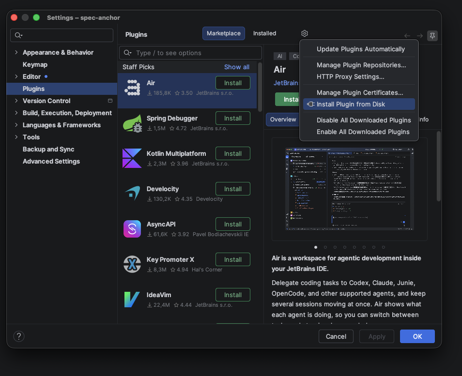
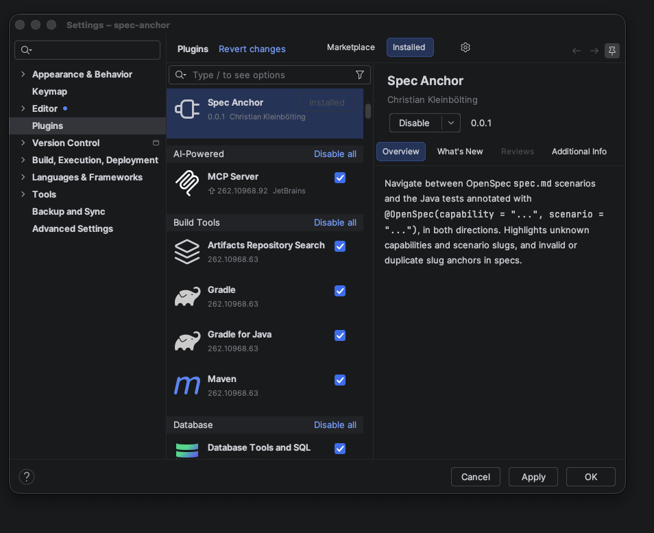

# Installation

You need two things: the annotation library on your test classpath, and the plugin in IntelliJ IDEA. The annotation works without the plugin (it is only metadata), but the plugin is what makes it useful while you work.

## Annotation library

`spec-anchor-annotations` is published to Maven Central. It needs Java 8 or later and brings in no other dependencies. Add it with test scope, since only tests use it.

### Gradle (Kotlin DSL)

```kotlin
dependencies {
    testImplementation("org.kleinb.openspec:spec-anchor-annotations:0.2.0")
}
```

### Gradle (Groovy DSL)

```groovy
dependencies {
    testImplementation 'org.kleinb.openspec:spec-anchor-annotations:0.2.0'
}
```

### Maven

```xml
<dependency>
    <groupId>org.kleinb.openspec</groupId>
    <artifactId>spec-anchor-annotations</artifactId>
    <version>0.2.0</version>
    <scope>test</scope>
</dependency>
```

The annotation is `org.kleinb.openspec.annotation.OpenSpec`.

## IntelliJ plugin

The plugin requires IntelliJ IDEA 2025.2 or later (Community or Ultimate) with the bundled *Java* and *Markdown* plugins enabled. It is not on the JetBrains Marketplace yet, so install it from disk:

1. Download `spec-anchor-intellij-plugin-<version>.zip` from the [GitHub releases](https://github.com/seakayone/spec-anchor/releases). Do not unpack it.
2. In IntelliJ, open *Settings → Plugins*, click the gear icon ⚙ and choose *Install Plugin from Disk*.

   

3. Pick the zip file and restart the IDE if asked.
4. Check that *Spec Anchor* is listed and enabled under *Settings → Plugins → Installed*.

   

To update, install the newer zip the same way; it replaces the old version.

## Project layout

The plugin looks for specs in the standard OpenSpec locations of the open project:

- `openspec/specs/**/spec.md`: the main specs.
- `openspec/changes/<change>/specs/**/spec.md`: specs in active changes, so you can link and review tests before a change is archived.

Specs below `openspec/changes/archive/` are ignored. No further configuration is needed.

Next: [link your first test](annotation.md).
