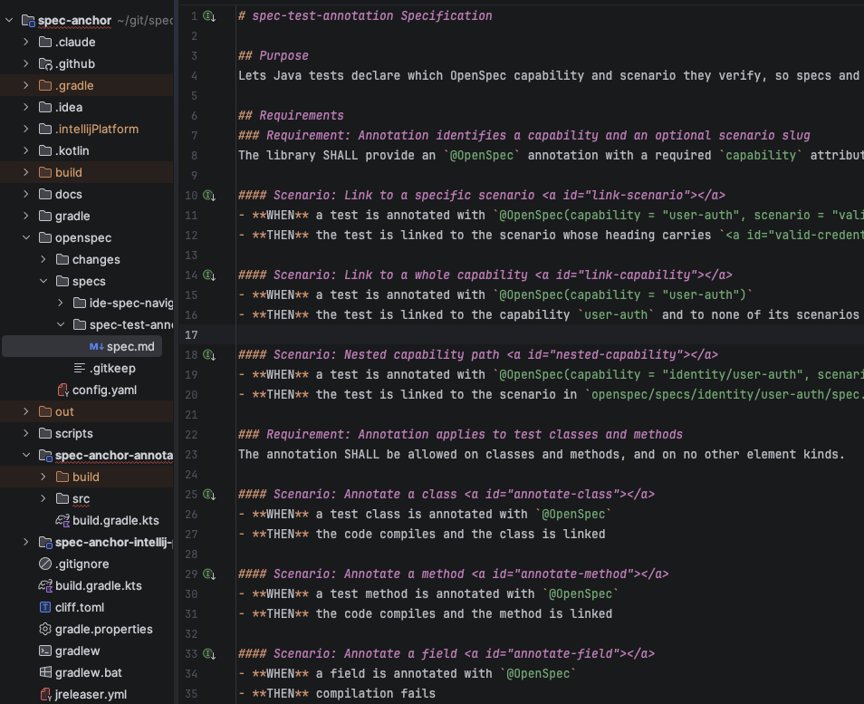
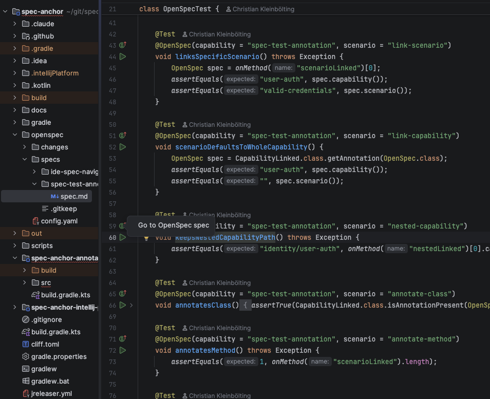
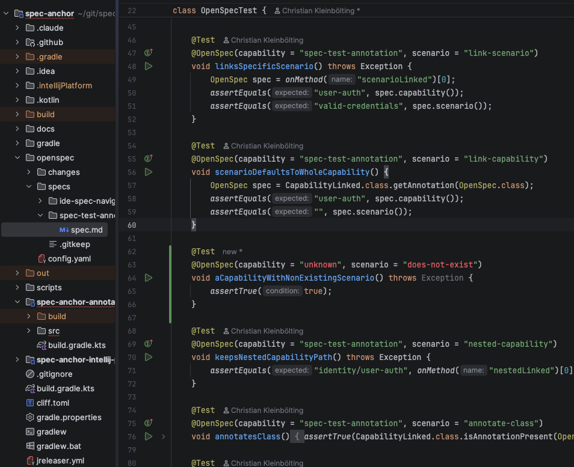
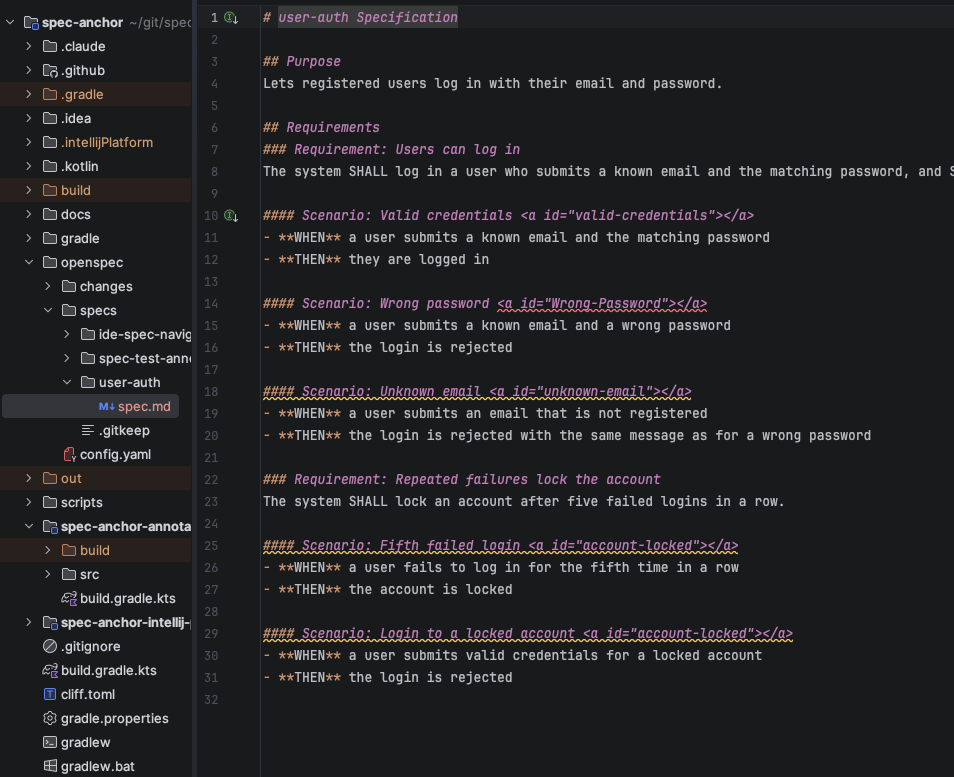
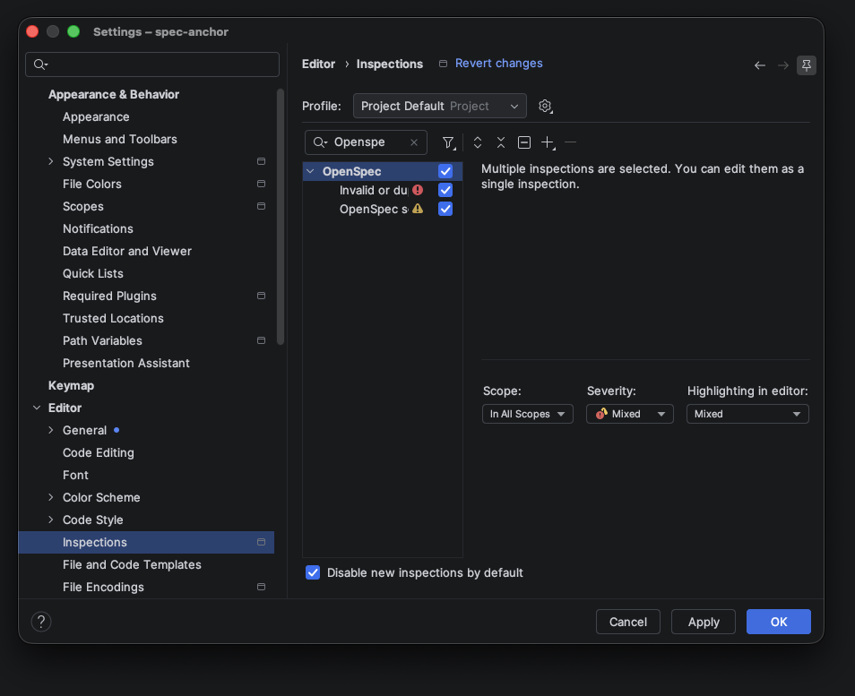

# The IntelliJ plugin

The Spec Anchor plugin connects `spec.md` files and `@OpenSpec`-annotated Java tests inside IntelliJ IDEA. See [Installation](installation.md) to set it up.

Everything updates as you type: renaming a scenario, changing a slug or adding a test is reflected immediately, without a rebuild or restart.

## From a scenario to its tests

Each `#### Scenario:` heading that has at least one linked test gets a gutter icon (tooltip *Go to linked tests*). Click it to open the test; if several tests are linked, a chooser lists them.

The first heading of the spec (the capability title) gets the same icon when any test links to the capability. It offers all of them: tests linked to the whole capability and tests linked to any of its scenarios.

Scenarios without a linked test show no icon.

## From a test to the spec

There are two ways to get from an annotation to the spec:

- **Gutter icon** next to the annotated class or method (tooltip *Go to OpenSpec spec*). It opens the referenced scenario heading, or the capability's `spec.md` if no scenario is given.
- **Go to declaration** (<kbd>Ctrl</kbd>/<kbd>⌘</kbd>+click, or <kbd>Ctrl</kbd>/<kbd>⌘</kbd>+<kbd>B</kbd>) on the `capability` value opens the spec file; on the `scenario` value it places the caret on the scenario heading.

When a capability exists both in `openspec/specs/` and in an active change under `openspec/changes/<change>/specs/`, both are valid targets and a chooser offers them.

## Highlighting

### Unknown references in tests

A `capability` value with no matching `spec.md` is highlighted as *Unknown OpenSpec capability*. A `scenario` value with no matching slug in that capability is highlighted as *Unknown scenario slug*. This catches typos, and tests left pointing at a slug that was renamed or removed.

Remember that slugs match exactly: `"Valid-Credentials"` or the scenario's name `"Valid credentials"` will not resolve to ``.

### Invalid or duplicate slugs in specs

Inspection *Invalid or duplicate OpenSpec scenario slug*:

- **Error** on an `` at the end of the heading with a valid slug. The rules are listed in [Step 1 of the annotation guide](annotation.md#step-1-give-the-scenario-a-slug).
- **Warning** on every scenario whose slug is also used by another scenario in the same `spec.md`.

### Untested scenarios

Inspection *OpenSpec scenario without linked test* warns on every scenario heading that has a slug but no test linked to that slug (*No test linked to scenario '…'*).

The warnings are visible in the screenshot above, on *Unknown email* and on the two *account-locked* scenarios.

- Only scenarios with a slug are checked. Leave a scenario unslugged if you do not want it tracked.
- A test linked to the whole capability does not cover its scenarios; link the scenario explicitly.
- Specs in active changes are checked as well; archived changes are not.
- Only Java tests are found.

Use *Code → Inspect Code…* with this inspection to list every untested scenario in the project at once.

## Settings

Both spec inspections are in *Settings → Editor → Inspections → OpenSpec* (type `OpenSpec` in the filter to find them quickly). There you can turn them off or change their severity, for example raise *OpenSpec scenario without linked test* to an error, or lower it to a weak warning while a spec is still being written.

## Limitations

- Only Java test sources are scanned; `@OpenSpec` in Kotlin or other JVM languages is not resolved.
- Specs must live in `openspec/` in the project; other locations are not discovered.
- The plugin is not on the JetBrains Marketplace yet, so it does not update automatically.

## Troubleshooting

**No gutter icons at all.** Check that the plugin is enabled under *Settings → Plugins*, that the spec is at `openspec/specs/<capability>/spec.md` (not in an archived change), and that indexing has finished.

**The annotation is highlighted as unknown although the spec exists.** Compare the `capability` value with the directory path below `openspec/specs/`, and the `scenario` value with the `id` in the heading, character for character.

**A scenario has no icon although a test links to it.** Make sure the anchor in the heading is not itself marked as an error; an invalid anchor gives the scenario no slug.
